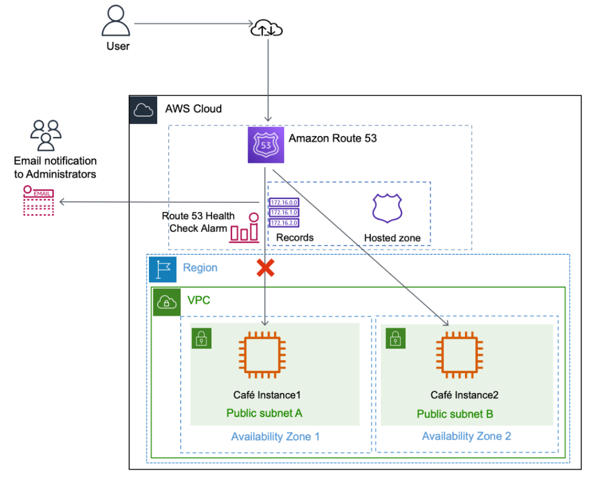
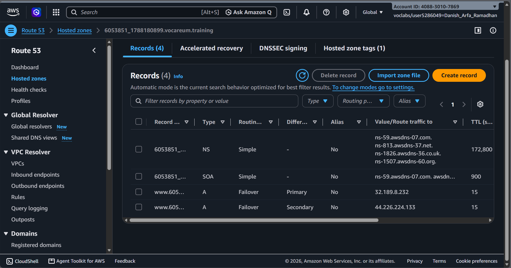
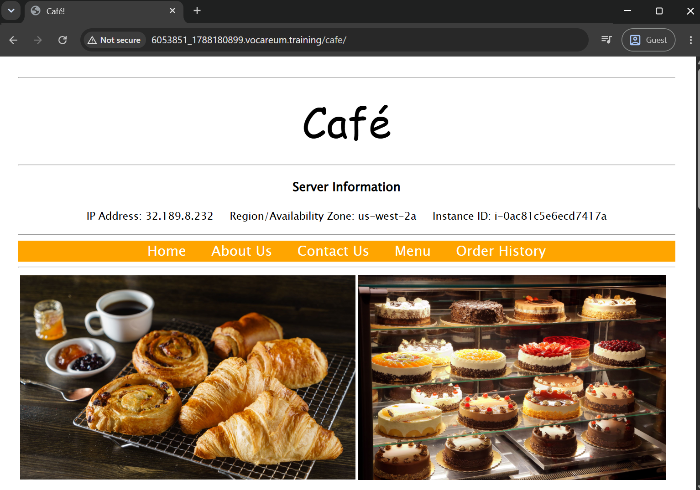
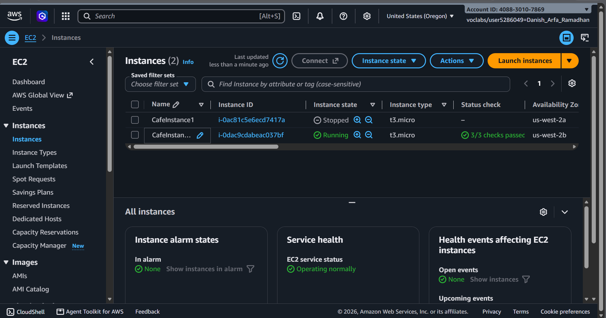
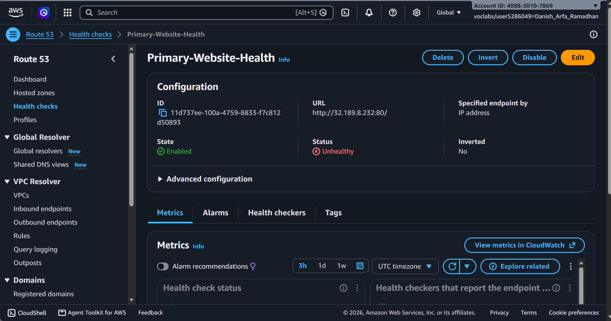
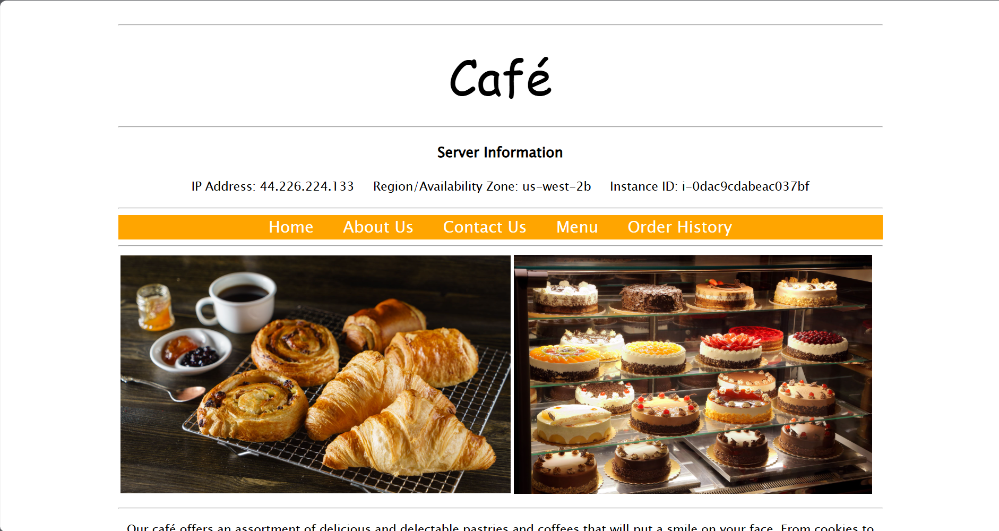

# Amazon Route 53 Failover Routing Lab

Repository ini berisi dokumentasi dan langkah-langkah konfigurasi failover routing menggunakan Amazon Route 53 pada dua EC2 instance yang berjalan di Availability Zone (AZ) berbeda.

## Arsitektur

Infrastruktur terdiri dari dua EC2 instance pada region `us-west-2`:
- **Primary Server**: CafeInstance1 (Availability Zone `us-west-2a`)
- **Secondary Server**: CafeInstance2 (Availability Zone `us-west-2b`)

---

## Langkah-Langkah Implementasi

### Task 1: Verifikasi Infrastruktur Awal
1. Buka konsol EC2 dan pastikan dua instance berikut sudah berjalan:
   - `CafeInstance1` di subnet `us-west-2a`
   - `CafeInstance2` di subnet `us-west-2b`
2. Buka URL `PrimaryWebSiteURL` dan `SecondaryWebsiteURL` di browser terpisah untuk memastikan kedua web server berjalan normal.
3. Catat IP Public dari masing-masing instance:
   - IP Primary: `32.189.8.232`
   - IP Secondary: `44.226.224.133`

### Task 2: Membuat Route 53 Health Check
1. Buka konsol Route 53, lalu pilih menu **Health checks**.
2. Pilih **Create health check** dan isi konfigurasi berikut:
   - **Name**: `Primary-Website-Health`
   - **What to monitor**: Endpoint
   - **Specify endpoint by**: IP address
   - **IP address**: `32.189.8.232` (IP Public CafeInstance1)
   - **Path**: `cafe`
3. Pada opsi **Advanced configuration**:
   - **Request interval**: Fast (10 seconds)
   - **Failure threshold**: 2
4. Simpan konfigurasi dan tunggu hingga status Health Check berubah menjadi *Healthy*.

### Task 3: Konfigurasi DNS Records di Route 53
Buka menu **Hosted zones**, lalu pilih nama domain lab yang tersedia (`vocareum.training`). Buat dua buah A Record dengan TTL 15 detik.

#### Task 3.1: Record Primary
- **Record name**: `www`
- **Record type**: `A`
- **Value**: `32.189.8.232`
- **TTL**: `15`
- **Routing policy**: Failover
- **Failover record type**: Primary
- **Health check ID**: Pilih `Primary-Website-Health`
- **Record ID**: `FailoverPrimary`

#### Task 3.2: Record Secondary
- **Record name**: `www`
- **Record type**: `A`
- **Value**: `44.226.224.133`
- **TTL**: `15`
- **Routing policy**: Failover
- **Failover record type**: Secondary
- **Health check ID**: *(kosongkan)*
- **Record ID**: `FailoverSecondary`

### Task 4: Verifikasi Resolusi DNS
1. Salin nama A Record yang telah dibuat (`http://www.XXXXXX.vocareum.training/cafe/`) dan buka di browser tab baru.
2. Pastikan halaman web café terbuka dan bagian **Server Information** menunjukkan server berjalan di **Availability Zone: us-west-2a**.

### Task 5: Pengujian Fungsi Failover
1. Buka konsol EC2, pilih `CafeInstance1`, lalu lakukan **Instance state > Stop instance** untuk menghentikan server utama.
   
2. Buka konsol Route 53 menu **Health checks** dan tunggu beberapa saat hingga status `Primary-Website-Health` berubah dari *Healthy* menjadi **Unhealthy**.
   
3. Kembali ke browser tab tempat web café dibuka, lalu lakukan **refresh** halaman.
4. Perhatikan bagian **Server Information** pada web. Informasi server akan otomatis berpindah ke **Availability Zone: us-west-2b** (Secondary Instance) tanpa perlu mengubah URL domain.
   

---

## Catatan Hak Akses IAM
Konfigurasi SNS Email Alarm tidak dilakukan pada lab ini karena adanya batasan *IAM Permission Policy* pada akun AWS Academy/Vocareum. Mekanisme pengalihan trafik (failover) Route 53 tetap berfungsi penuh berdasarkan status Health Check yang dikonfigurasi.
